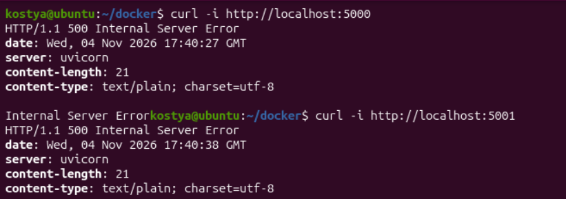
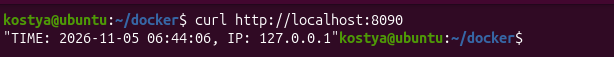
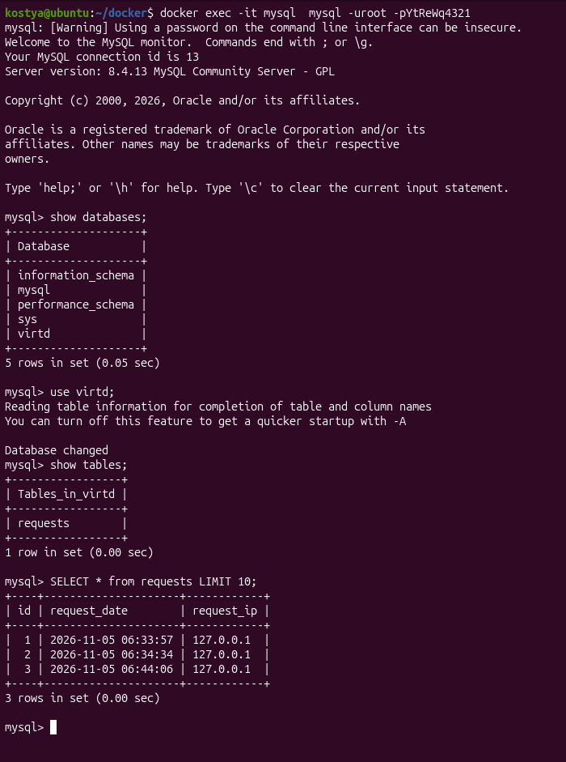
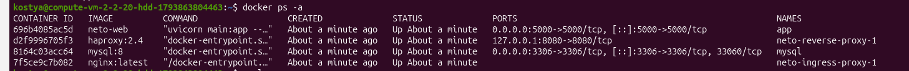
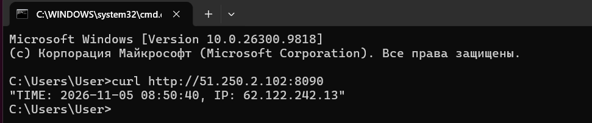
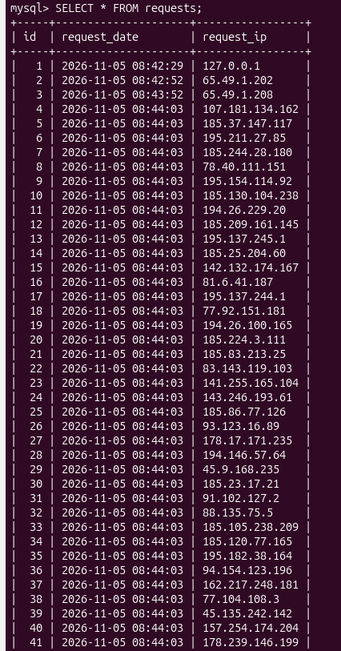
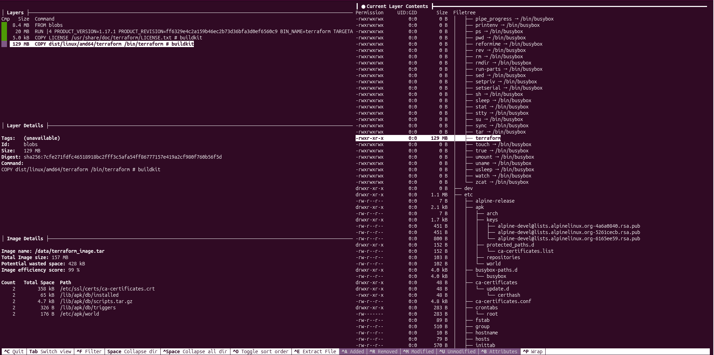
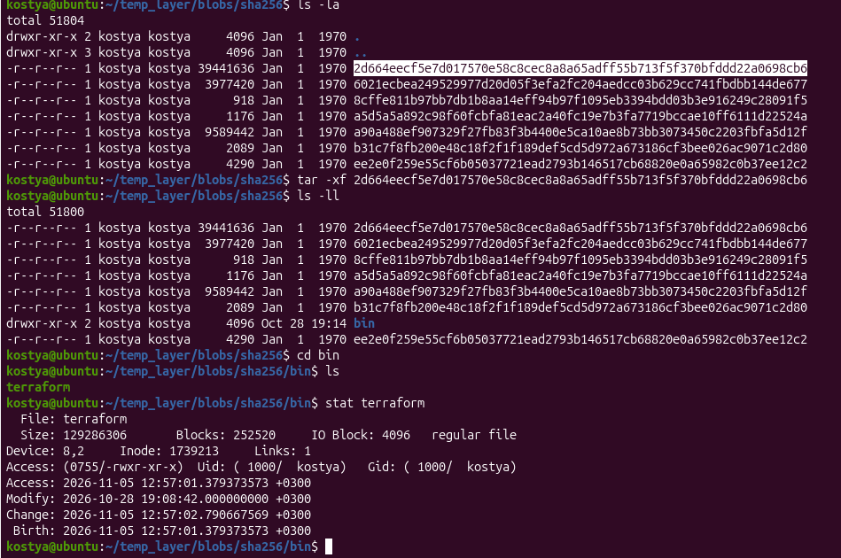

**Задача 1**

1.  Сделайте в своем GitHub пространстве fork [репозитория](https://github.com/netology-code/shvirtd-example-python).

2.  Создайте файл Dockerfile.python на основе существующего Dockerfile:

    - Используйте базовый образ python:3.12-slim

    - Обязательно используйте конструкцию COPY . . в Dockerfile

    - Создайте .dockerignore файл для исключения ненужных файлов

    - Используйте CMD \["uvicorn", "main:app", "--host", "0.0.0.0", "--port", "5000"\] для запуска

    - Протестируйте корректность сборки 2.1 Используйте multistage сборку вместо single stage.

**Решение**

**.dockerignore**

```
__pycache__  
*.pyc  
*.pyo  
.venv  
venv  
  
.git  
.gitignore  
.DS_Store  
  
tmp/  
logs/  
  
Dockerfile
```

**Dockerfile.python**

FROM python:3.12-slim  
WORKDIR /app  
COPY requirements.txt .  
RUN pip install --no-cache-dir -r requirements.txt  
COPY . .  
EXPOSE 5000  
CMD \["uvicorn", "main:app", "--host", "0.0.0.0", "--port", "5000"\]

**Dockerfile-multi.python**

FROM python:3.12-slim AS builder  
WORKDIR /app  
COPY requirements.txt .  
RUN pip install --no-cache-dir -r requirements.txt  
  
FROM python:3.12-slim  
WORKDIR /app  
COPY --from=builder /usr/local/lib/python3.12/site-packages/ /usr/local/lib/python3.12/site-packages/  
COPY --from=builder /usr/local/bin /usr/local/bin  
COPY . .  
EXPOSE 5000  
CMD \["uvicorn", "main:app", "--host", "0.0.0.0", "--port", "5000"\]

**docker build -f Dockerfile.python -t app-single .**

**docker build -f Dockerfile-multi.python -t app-multi .**


**docker run -d -p 5000:5000 app-single:latest**

**docker run -d -p 5001:5000 app-multi:latest**

**curl -i <http://localhost:5000>**

**curl -i [http://localhost:5001](http://localhost:50010)**



**Задача 3**

1.  Изучите файл "proxy.yaml"

2.  Создайте в репозитории с проектом файл compose.yaml. С помощью директивы "include" подключите к нему файл "proxy.yaml".

3.  Опишите в файле compose.yaml следующие сервисы:

- web. Образ приложения должен ИЛИ собираться при запуске compose из файла Dockerfile.python ИЛИ скачиваться из yandex cloud container registry(из задание №2 со \*). Контейнер должен работать в bridge-сети с названием backend и иметь фиксированный ipv4-адрес 172.20.0.5. Сервис должен всегда перезапускаться в случае ошибок. Передайте необходимые ENV-переменные для подключения к Mysql базе данных по сетевому имени сервиса web

- db. image=mysql:8. Контейнер должен работать в bridge-сети с названием backend и иметь фиксированный ipv4-адрес 172.20.0.10. Явно перезапуск сервиса в случае ошибок. Передайте необходимые ENV-переменные для создания: пароля root пользователя, создания базы данных, пользователя и пароля для web-приложения.Обязательно используйте уже существующий .env file для назначения секретных ENV-переменных!

2.  Запустите проект локально с помощью docker compose , добейтесь его стабильной работы: команда curl -L http://127.0.0.1:8090 должна возвращать в качестве ответа время и локальный IP-адрес. Если сервисы не стартуют воспользуйтесь командами: docker ps -a  и docker logs \<container_name\> . Если вместо IP-адреса вы получаете информационную ошибку --убедитесь, что вы шлете запрос на порт 8090, а не 5000.

3.  Подключитесь к БД mysql с помощью команды docker exec -ti \<имя_контейнера\> mysql -uroot -p\<пароль root-пользователя\>(обратите внимание что между ключем -u и логином root нет пробела. это важно!!! тоже самое с паролем) . Введите последовательно команды (не забываем в конце символ ; ): show databases; use \<имя вашей базы данных(по-умолчанию virtd, как это указано в .env)\>; show tables; SELECT \* from requests LIMIT 10;. Примечание: таблица в БД создается после первого поступившего запроса к приложению.

4.  Остановите проект. В качестве ответа приложите скриншот sql-запроса.

**Решение**

**Compose.yaml**

include:  
- proxy.yaml  
  
services:  
web:  
build:  
context: .  
dockerfile: Dockerfile.python  
container_name: app  
ports:  
- "5000:5000"  
volumes:  
- .:/app  
restart: always  
networks:  
backend:  
ipv4_address: 172.120.0.5  
depends_on:  
- db  
environment:  
- DB_HOST=db  
- DB_PORT=3306  
- DB_USER=\${MYSQL_USER}  
- DB_PASSWORD=\${MYSQL_PASSWORD}  
- DB_NAME=\${MYSQL_DATABASE}  
  
db:  
image: mysql:8  
container_name: mysql  
restart: always  
networks:  
backend:  
ipv4_address: 172.120.0.10  
ports:  
- "3306:3306"  
environment:  
- MYSQL_ROOT_PASSWORD=\${MYSQL_ROOT_PASSWORD}  
- MYSQL_DATABASE=\${MYSQL_DATABASE}  
- MYSQL_USER=\${MYSQL_USER}  
- MYSQL_PASSWORD=\${MYSQL_PASSWORD}

**Proxy.yaml**

services:  
  
reverse-proxy:  
image: haproxy:2.4  
restart: always  
networks:  
backend:  
ipv4_address: 172.120.0.15  
ports:  
- "127.0.0.1:8080:8080"  
volumes:  
- ./haproxy/reverse/haproxy.cfg:/usr/local/etc/haproxy/haproxy.cfg:rw  
  
ingress-proxy:  
image: nginx:latest  
restart: always  
network_mode: host  
volumes:  
- ./nginx/ingress/default.conf:/etc/nginx/conf.d/default.conf:rw  
- ./nginx/ingress/nginx.conf:/etc/nginx/nginx.conf:rw  
  
networks:  
backend:  
driver: bridge  
ipam:  
config:  
- subnet: 172.120.0.0/24

**Исправить IP-адрес в конфигурации HAproxy.**

**docker compose up -d**

**curl <http://localhost:8090>**



**docker exec -it mysql mysql -uroot -pYtReWq4321**



**Docker compose down**

**Задача 4**

1.  Запустите в Yandex Cloud ВМ (вам хватит 2 Гб Ram).

2.  Подключитесь к Вм по ssh и установите docker.

3.  Напишите bash-скрипт, который скачает ваш fork-репозиторий в каталог /opt и запустит проект целиком.

4.  Зайдите на сайт проверки http подключений, например(или аналогичный): https://check-host.net/check-http и запустите проверку вашего сервиса http://\<внешний_IP-адрес_вашей_ВМ\>:8090. Таким образом трафик будет направлен в ingress-proxy. Трафик должен пройти через цепочки: Пользователь → Internet → Nginx → HAProxy → FastAPI(запись в БД) → HAProxy → Nginx → Internet → Пользователь

5.  (Необязательная часть) Дополнительно настройте remote ssh context к вашему серверу. Отобразите список контекстов и результат удаленного выполнения docker ps -a

6.  Повторите SQL-запрос на сервере и приложите скриншот и ссылку на fork.

**Решение**

**Создаем ВМ**

**Start.sh**

\#!/usr/bin/bash  
  
REPO_URL="https://github.com/kmenovschikov/netology_devops.git"  
REPO_DIR="/opt/neto"  
  
echo "Клонируем репозиторий в \$REPO_DIR..."  
git clone "\$REPO_URL" "\$REPO_DIR"  
  
  
echo "Заходим в папку \$REPO_DIR и запускаем docker compose..."  
(cd "\$REPO_DIR" && docker compose up -d)

**Sudo bash start.ph**







[**https://github.com/kmenovschikov/netology_devops**](https://github.com/kmenovschikov/netology_devops)

**Задача 6**

Скачайте docker образ hashicorp/terraform:latest и скопируйте бинарный файл /bin/terraform на свою локальную машину, используя dive и docker save. Предоставьте скриншоты действий.

**Решение**

**docker pull hashicorp/terraform:latest**

**dive hashicorp/terraform:latest**



**docker save hashicorp/terraform:latest -o terraform_image.tar**

**tar -xf terraform_image.tar temp_layer**

**Ищем нужный слой и распаковывем**


